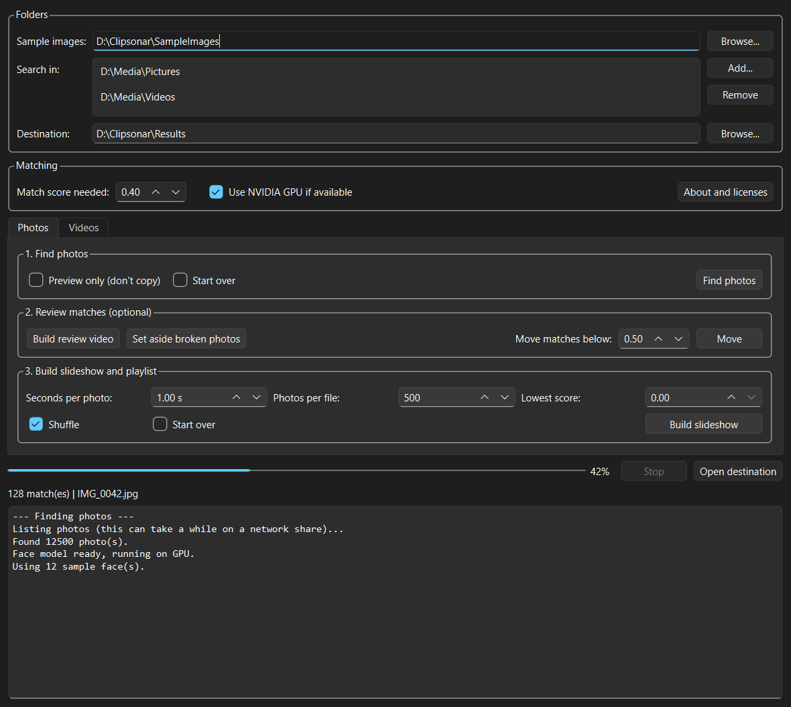

# Clipsonar

Create slideshows of one person from your images and videos. Give Clipsonar a few sample images, and it searches your library, copies the matching photos, and cuts short clips from the matching videos. It then turns them into MP4 slideshows with a playlist you can open in VLC.

Photos and video clips are built separately, so you get one slideshow for each.

Everything runs on your own computer, and your media is never uploaded. The only download is the face model, the first time you scan.



## Features

- **Desktop app:** pick your sample images, the folders to search, and a destination.
- **Photos:** searches subfolders and copies matches, with the match score in each file name. Your originals are only read.
- **Videos:** samples frames and cuts a clip around each appearance.
- **Slideshows and playlists:** builds batched MP4s and an `.m3u` playlist that plays them back to back. Clips from different cameras are converted to one format first.
- **Built for big libraries and network drives:** stop at any time and the next run resumes where it left off.
- **Review tools:** a labeled video for spotting false matches, a low-score filter, and a check for corrupt photos.
- **GPU support:** with the source install, tick **Use NVIDIA GPU if available** for much faster scans. Otherwise it runs on the CPU.

## Install

Clipsonar is built for Windows. Either way, you also need FFmpeg:

```bash
winget install ffmpeg
```

### Option 1: download the app (CPU only)

Download `Clipsonar-windows-cpu.zip` from [Releases](https://github.com/bsoverns/Clipsonar/releases), unzip it, and run `Clipsonar.exe`.

### Option 2: install from source (needed for GPU)

This needs [Python 3.13](https://www.python.org/downloads/). InsightFace also compiles a small extension during install, so you may need [Microsoft C++ Build Tools](https://visualstudio.microsoft.com/visual-cpp-build-tools/).

```powershell
git clone https://github.com/bsoverns/Clipsonar.git
cd Clipsonar
.\scripts\setup.ps1        # add -Cpu if you have no NVIDIA GPU
.\.venv\Scripts\clipsonar-gui.exe
```

## How to use it

1. **Sample images:** choose a folder with clear photos of the person. A variety of ages, angles and lighting helps. If a photo has several people, Clipsonar uses the largest face.
2. **Search in:** add one or more folders. Network paths work.
3. **Destination:** choose where results go.
4. **Photos tab:** click **Find photos**, optionally review the matches, then click **Build slideshow**.
5. **Videos tab:** click **Find clips**, then **Build montage**.
6. Open `playlist.m3u` from the destination's `montages` folder in VLC.

### Choosing a match score

The score runs from 0 to 1. The default of **0.40** finds more matches but includes some wrong ones, and 0.50 or higher is stricter. For photos, changing the score and running again applies it to earlier results without rescanning, though photos already copied stay in the folder. To remove those, use **Move matches below**.

### Removing wrong matches

Click **Build review video**, which shows each photo with its file name on screen. Pause on a wrong photo, then delete that file from the `matches` folder. It stays deleted on later scans unless you use **Start over**. Then rebuild the slideshow with **Start over** ticked.

### What goes in the destination

```text
<destination>/
├── photos/
│   ├── matches/            copies of matching photos, like IMG_0042__s0.62.jpg
│   ├── montages/           Montage_batch_001.mp4 ..., playlist.m3u, PhotoReview.mp4
│   └── hits.csv            every photo scanned, with its score
└── videos/
    ├── clips/              extracted clips
    ├── montages/           Montage_batch_001.mp4 ..., playlist.m3u
    ├── hits.csv            every match, with its time and score
    ├── state.json          which videos are finished or failed
    └── extract.log         details for each clip
```

### What can change your files

- **Original photos** are only read.
- **Original videos** are only read, unless you tick **Move failed ORIGINAL videos out of their folders**. It's off by default and asks before it runs.
- **Start over** deletes earlier results for that step, inside the destination only, after asking you to confirm.
- **Montage building** moves copies that fail into a `broken_photos` or `broken_clips` folder. Nothing is deleted.

## Command line

Every button has a matching command:

```powershell
clipsonar photos --samples D:\Samples --sources D:\Pictures E:\Backup --out D:\Results --gpu
clipsonar videos --samples D:\Samples --sources D:\Videos --out D:\Results --gpu
clipsonar photo-montage --out D:\Results --duration 0.75 --min-score 0.50
clipsonar video-montage --out D:\Results
clipsonar review --out D:\Results
clipsonar --help
```

## Responsible use

Face recognition is sensitive. Clipsonar is meant for sorting your own personal media, and you should only use it on media you have the right to process. Don't use it to identify or track people without their permission. Biometric data is regulated in many places, so it's your responsibility to follow the law where you live.

Your results folder and sample images can identify real people, including children, so keep them private and out of source control. This repository's `.gitignore` and CI check block media and scan results as a safeguard.

## License

Clipsonar's code is under the [MIT License](LICENSE).

**The face model has a different license.** Clipsonar downloads the InsightFace `buffalo_l` model on first use. InsightFace's code is MIT, but its models are for **non-commercial research only** unless you get a license from InsightFace. The MIT License on Clipsonar doesn't change that.

See [THIRD_PARTY_NOTICES.md](THIRD_PARTY_NOTICES.md) for the full list of licenses, including those for ONNX Runtime, OpenCV, PySide6/Qt and FFmpeg.

## Development

```powershell
py -3.13 -m venv .venv
.\.venv\Scripts\python.exe -m pip install -e ".[cpu,dev]"
.\.venv\Scripts\python.exe -m pytest
.\.venv\Scripts\python.exe -m ruff check .
```

Tests generate their own media and store no images of people. Tests that need the real face model skip themselves if it isn't downloaded.

To release a new version, update `__version__` in `src/clipsonar/__init__.py`, then push a tag such as `v0.1.0`. GitHub Actions builds the Windows zip and publishes the release.
